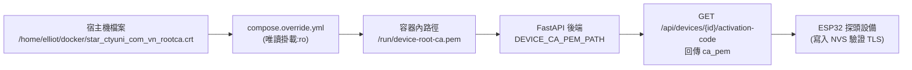

# ESP32 設備根憑證 (Root CA) 管理與更新手冊

本手冊說明 Uni-President「3 Tốt」養蝦監測系統中，ESP32 探頭進行 HTTPS 連線時所需的伺服器根 CA 憑證（`DEVICE_CA_PEM_PATH`）規範、剖析原理、自動化工具與日後更換憑證的操作流程。

---

## 一、核心規範與限制

依據 [docs/probe-ingest.md](probe-ingest.md) 與後端檢核邏輯（`backend/routers/devices.py`），`DEVICE_CA_PEM_PATH` 必須符合以下嚴格條件：

1. **單一公開憑證**：必須是單一 X.509 PEM 憑證，**嚴禁包含憑證鏈（Bundle）、中繼憑證或伺服器私鑰**。
2. **長度限制**：字元長度不得超過 **4096 字元**。
3. **格式規範**：必須完全匹配正規表示式：
   ```regexp
   ^-----BEGIN CERTIFICATE-----\s+[A-Za-z0-9+/=\s]+-----END CERTIFICATE-----$
   ```
4. **信任錨點 (Trust Anchor)**：必須為該網域 TLS 憑證鏈的頂層根憑證（通常為自簽署 Root CA，即 `Subject == Issuer`）。

> [!NOTE] 為什麼不能直接放憑證商提供的 CA Bundle？
> 1. **ESP32 資源限制**：ESP32 的 NVS（非揮發性儲存）以 Key-Value 存放字串，單一字串超過 2~4KB 時儲存容易失敗；TLS 握手時 Microcontroller 的記憶體也極為有限。
> 2. **伺服器職責**：中繼憑證（Intermediate CA）已由 Web 伺服器（如 Nginx、Nginx Proxy Manager）在 TLS 握手時主動傳送給客戶端。客戶端（ESP32）僅需持有一張頂層 Root CA 即可完成整條信任鏈的驗證。

---

## 二、深度解析：為何必須使用 R46 而非 USERTrust？

向 CA 廠商（如 Sectigo、Comodo）申請憑證時，下載的 Bundle 通常包含以下 3 張憑證：
1. `Sectigo Public Server Authentication CA DV R36`（直接簽發你網域的中繼憑證）
2. `Sectigo Public Server Authentication Root R46`（簽發中繼憑證的現代根節點，大小 2,341 位元組）
3. `USERTrust RSA Certification Authority`（2010 年老舊的自簽署根憑證，大小 2,093 位元組）

### 為什麼 ESP32 填入 USERTrust 會連線失敗，換成 R46 才能成功？

#### 1. 憑證簽發關係（Issuer 判定）
檢視各層憑證的發行者：
* 你的網域憑證（`*.ctyuni.com.vn`）$\to$ 由 `CA DV R36` 簽發。
* 中繼憑證（`CA DV R36`）$\to$ **直接由 `Sectigo Public Server Authentication Root R46` 簽發**！

#### 2. 交叉簽署（Cross-Signing）的本質
`USERTrust` 是 Sectigo 在十幾年前建立的老根憑證。為了讓「不認識現代 R46 的老舊作業系統（如 Windows XP、舊 Android）」也能信任你的網站，Sectigo 額外用 `USERTrust` 替 `R46` 做了一次**交叉簽署**。
* **桌面瀏覽器**：內部內建了數百張根憑證，無論走 R46 或走 USERTrust 都能自動搜尋並驗證通過。
* **ESP32 (mbedTLS) 嵌入式架構**：
  * **深度限制（Depth Limit）**：ESP32 的 `WiFiClientSecure` 記憶體有限，mbedTLS 預設的中繼深度（`MAX_INTERMEDIATE_CA`）非常短。若指定 USERTrust，憑證鏈長達 4 層（網域 $\to$ R36 $\to$ R46 $\to$ USERTrust），會直接超出深度限制或封包緩衝區（Buffer Overflow）而報錯。
  * **4096-bit 運算負擔**：USERTrust 是 4096-bit RSA，解析與大數解密極度消耗微控制器 SRAM，容易引發記憶體不足（OOM）。
  * **短鏈優勢（Early Exit）**：若將信任錨點設為 **R46**，ESP32 收到伺服器的 R36 中繼憑證時，發現簽發者就是 R46，便會在第 1 層中繼直接比對成功終止驗證，鏈長減半，連線即可瞬間秒成！

因此，針對 ESP32 等 IoT 設備，**務必使用直接簽發中繼憑證的 Root CA（即 R46）**，避免使用深層交叉簽署的老根憑證。


---

## 三、快速更新流程（使用自動化腳本）

專案已內建憑證解析、合約檢驗與自動更新工具：[`scripts/update_device_ca.py`](../scripts/update_device_ca.py)。

### 1. 腳本參數說明

| 參數 | 簡寫 | 必要 | 預設值 | 說明 |
|---|---|---|---|---|
| `--input` | `-i` | **是** | - | 來源憑證檔案路徑（可傳入單張 `.crt`、`.pem` 或廠商提供的 `.ca-bundle`） |
| `--output` | `-o` | 否 | `/home/elliot/docker/star_ctyuni_com_vn_rootca.crt` | 輸出單一根憑證的目標路徑 |
| `--test-domain` | `-d` | 否 | （無） | 憑證寫入後，連線並測試指定網域的 TLS 握手（例如 `uni-shrimp.ctyuni.com.vn`） |
| `--test-port` | `-p` | 否 | `443` | TLS 握手測試之連接埠 |
| `--restart` | - | 否 | `False` | 憑證寫入後，自動執行 `docker compose up -d backend` 重啟後端容器套用 |
| `--no-backup` | - | 否 | `False` | 覆蓋目標檔案前不進行備份（預設會自動備份為 `*.crt.bak_YYYYMMDD_HHMMSS`） |

---

### 2. 常見操作情境與範例

#### 情境 A：標準更新（推薦流程）
向廠商取得新憑證後，解析自簽署根憑證、自動備份舊檔、覆蓋目標並重啟後端：
```bash
python3 scripts/update_device_ca.py \
  -i /path/to/new_bundle.crt \
  --restart
```

#### 情境 B：更新後連帶驗證 HTTPS 網域握手
若伺服器已有 Nginx 反向代理或已啟用 HTTPS，可一併驗證該 Root CA 是否能順利驗證對端網域：
```bash
python3 scripts/update_device_ca.py \
  -i /path/to/new_bundle.crt \
  -d uni-shrimp.ctyuni.com.vn \
  --restart
```

#### 情境 C：預覽檢驗（不直接覆蓋正式檔案）
若只想檢視 Bundle 內容並輸出至暫存檔進行檢查：
```bash
python3 scripts/update_device_ca.py \
  -i /path/to/new_bundle.crt \
  -o /tmp/test_root_ca.pem \
  --no-backup
```

---

### 3. 腳本執行過程與輸出說明

當執行 `scripts/update_device_ca.py` 時，終端輸出範例如下：

```text
[*] 來源檔案: /path/to/new_bundle.crt (共找到 3 張憑證)
----------------------------------------------------------------------
[1] [中間憑證 (Intermediate CA)]
    Subject: C = GB, O = Sectigo Limited, CN = Sectigo Public Server Authentication CA DV R36
    Issuer:  C = GB, O = Sectigo Limited, CN = Sectigo Public Server Authentication Root R46
    Validity: notBefore=Mar 22 00:00:00 2021 GMT ~ notAfter=Mar 21 23:59:59 2036 GMT
    Size:     2243 bytes
[2] [中間憑證 (Intermediate CA)]
    Subject: C = GB, O = Sectigo Limited, CN = Sectigo Public Server Authentication Root R46
    Issuer:  C = US, ST = New Jersey, L = Jersey City, O = The USERTRUST Network, CN = USERTrust RSA Certification Authority
    Validity: notBefore=Mar 22 00:00:00 2021 GMT ~ notAfter=Jan 18 23:59:59 2038 GMT
    Size:     2341 bytes
[3] [自簽署根 CA (Root CA)]
    Subject: C = US, ST = New Jersey, L = Jersey City, O = The USERTRUST Network, CN = USERTrust RSA Certification Authority
    Issuer:  C = US, ST = New Jersey, L = Jersey City, O = The USERTRUST Network, CN = USERTrust RSA Certification Authority
    Validity: notBefore=Feb  1 00:00:00 2010 GMT ~ notAfter=Jan 18 23:59:59 2038 GMT
    Size:     2093 bytes
----------------------------------------------------------------------
[+] 自動選中自簽署 Root CA: 憑證 [3]
[*] 正在檢驗是否符合 Uni-Shrimp probe-ingest 規範...
[V] 驗證通過！憑證為單一 PEM，長度 2093 字元 (<= 4096)，SSLContext 載入正常。
[+] 已備份原憑證至: /home/elliot/docker/star_ctyuni_com_vn_rootca.crt.bak_20261110_105028
[+] 成功寫入單一根 CA 憑證至: /home/elliot/docker/star_ctyuni_com_vn_rootca.crt
----------------------------------------------------------------------
[*] 正在對 uni-shrimp.ctyuni.com.vn:443 執行 TLS 握手驗證...
[V] TLS 握手驗證成功！對端憑證 Subject: ((('commonName', '*.ctyuni.com.vn'),),)
----------------------------------------------------------------------
[*] 正在重新啟動後端容器 (docker compose up -d backend)...
[+] up 1/1
 ✔ Container uni-shrimp-backend Started
[V] 後端容器重啟成功！
----------------------------------------------------------------------
完成！
```

* **解析階段**：自動掃描並標註每張憑證是中繼憑證或自簽署根 CA。
* **檢驗階段**：依據 `backend/routers/devices.py` 嚴格把關字元長度（$\le 4096$）與正規表達式格式。若不合規範，腳本會立即中斷並報錯，防止錯誤憑證被部署上線。
* **備份與寫入**：確保有時間戳的歷史備份可隨時回滾。
* **重啟生效**：後端容器重新載入掛載檔案，前端「設備管理 > 產生啟用碼」即刻生效。

---

## 四、手動更新方式（備用）

若臨時無法執行 Python 腳本，可使用 OpenSSL 手動提取：

### 步驟 1：檢視來源檔案內的憑證
```bash
openssl crl2pkcs7 -nocrl -certfile /path/to/bundle.crt | openssl pkcs7 -print_certs -text -noout | grep -E "Subject:|Issuer:"
```

### 步驟 2：分割憑證並找出 Root CA
```bash
awk 'BEGIN {c=0;} /-----BEGIN CERTIFICATE-----/ {c++} {print > "/tmp/cert_" c ".crt"}' /path/to/bundle.crt

for f in /tmp/cert_*.crt; do
  echo "=== $f ==="
  openssl x509 -in "$f" -noout -subject -issuer
done
```
找出 `subject` 與 `issuer` **完全相同**的那一個（即 Self-signed Root CA）。

### 步驟 3：確認大小並覆蓋目標檔案
```bash
# 確認字元數小於 4096
wc -c /tmp/cert_X.crt

# 備份舊檔案並替換
cp /home/elliot/docker/star_ctyuni_com_vn_rootca.crt /home/elliot/docker/star_ctyuni_com_vn_rootca.crt.bak
cp /tmp/cert_X.crt /home/elliot/docker/star_ctyuni_com_vn_rootca.crt
rm -f /tmp/cert_*.crt
```

---

## 五、Docker 部署架構說明

在 Docker 容器化環境中，主機憑證透過以下架構掛載進容器：



### 1. `compose.override.yml`
```yaml
services:
  backend:
    volumes:
      - /home/elliot/docker/star_ctyuni_com_vn_rootca.crt:/run/device-root-ca.pem:ro
```

### 2. `.env` 設定
```dotenv
COMPOSE_FILE=compose.production.yml:compose.override.yml
DEVICE_CA_PEM_PATH=/run/device-root-ca.pem
```

---

## 六、更換後檢驗清單

憑證更換完成後，請依序執行以下檢驗：

1. **容器內憑證載入檢測**：
   ```bash
   docker exec uni-shrimp-backend python -c '
   from routers.devices import _device_ca_pem
   ca = _device_ca_pem()
   print("載入狀態:", bool(ca), "字元長度:", len(ca) if ca else 0)
   '
   ```
   預期輸出：`載入狀態: True 字元長度: 2093`（小於 4096）。

2. **後端健康檢查**：
   ```bash
   docker compose ps
   ```
   確認 `uni-shrimp-backend` 狀態為 `healthy`。

3. **前端管理介面驗證**：
   - 登入 Web 介面。
   - 前往「設備管理」頁面。
   - 點擊任意設備的「產生啟用碼」。
   - 確認對話框中的「根憑證 PEM」欄位有正確顯示憑證內容，無「缺少 PEM」之警告訊息。
